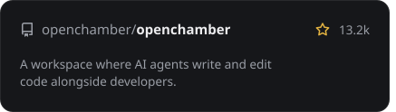
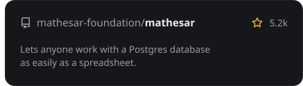

  

Teal keys type my handle. Grey keys are the tools I build with. Time zone: EST (UTC−5).

### Open source I've shipped to

Have an open-source idea or project? I'm open to collaborating. [Open an issue](https://github.com/devaaks/devaaks/issues/new) on this repo or email me at [devaks24k@gmail.com](mailto:devaks24k@gmail.com).

### Activity

<picture>
  <source media="(prefers-color-scheme: dark)" srcset="https://raw.githubusercontent.com/devaaks/devaaks/output/github-contribution-grid-snake-dark.svg" />
  
</picture>

### Say hi

<kbd>return ↵</kbd> &nbsp;[devaks24k@gmail.com](mailto:devaks24k@gmail.com) &nbsp;·&nbsp; or [open an issue](https://github.com/devaaks/devaaks/issues/new) on this repo.
